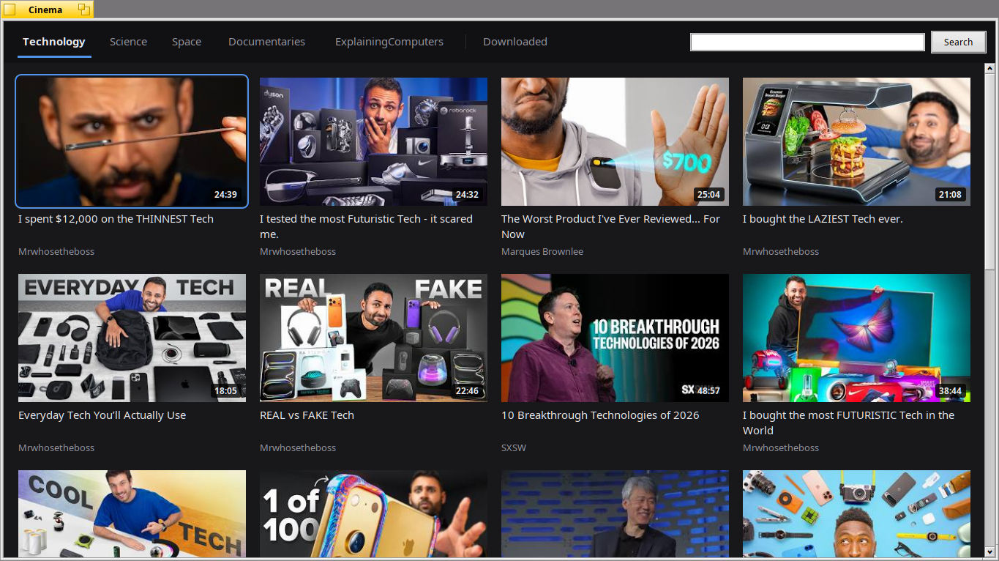
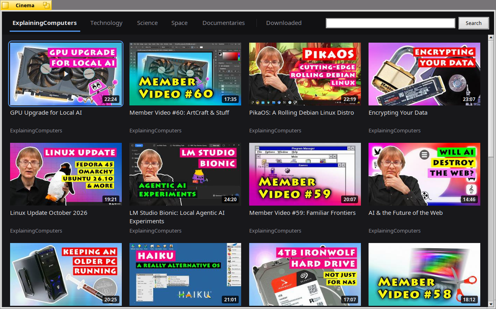

# Cinema

YouTube videos on [Haiku](https://www.haiku-os.org) and
[RenkuOS](https://github.com/RenkuOS): found with
[yt-dlp](https://github.com/yt-dlp/yt-dlp) and played by MediaPlayer.

It runs on x86_64, and on 32-bit ARM with RenkuOS, for example on the Toshiba
AC100.



## What it does

- **Tabs** at the top: searches, or channels whose latest videos are shown.
  They are kept in `~/config/settings/Cinema/categories`, one per line:
  `Name = what to search on YouTube`, or `Name = channel:<id>`.
- **Channels**: the name of the channel is under each video; a click shows its
  latest videos, and the **+** button next to its tab keeps it among the tabs
  (a right click on the name does it too). A right click on a tab removes it.
- **Downloads** to watch offline: press **D** on a video, or right click it.
  The files go to `~/Cinema`, with their title, channel and length in
  attributes, and are listed in the **Downloaded** tab, which works without the
  network. A video downloaded plays from its file wherever it is shown.
- **Keys**: arrows to choose, **Enter** or **Space** to play, **D** to download,
  **F** for full screen and **Esc** to go back. **Tab** or **F6** goes to the
  top tabs, the arrows choose one and **Enter** opens it. A gamepad works too:
  its D-pad or left stick chooses, **A** plays, **B** goes back, **X** downloads
  and **Y** toggles full screen; **L1** or **Start** goes to the top tabs.
- English, Italian, German, French, Spanish and Portuguese.

Videos are played in a single MP4 file (H.264 and AAC, 360p), which MediaPlayer
plays well also on slow machines such as the Toshiba AC100.



## Installing

The [releases](https://github.com/atomozero/Cinema/releases) have packages for
x86_64 and 32-bit ARM:

```sh
pkgman install cinema-1.0.0-2-x86_64.hpkg
```

On x86_64 this brings Python and the yt-dlp module from HaikuPorts too.

On ARM, where HaikuPorts has no yt-dlp package, put the single-file release of
yt-dlp in the `PATH`:

```sh
mkdir -p ~/config/non-packaged/bin
curl -L -o ~/config/non-packaged/bin/yt-dlp \
	https://github.com/yt-dlp/yt-dlp/releases/latest/download/yt-dlp
chmod +x ~/config/non-packaged/bin/yt-dlp
```

YouTube changes often: when videos stop being found, a newer yt-dlp usually
helps (`pkgman update`, or the same `curl` again).

## Needs

- `python3` and yt-dlp, either the Python module (`yt_dlp_python3.14`,
  matching your Python) or the single-file `yt-dlp` in the `PATH`.
- `curl`, for the pictures.

yt-dlp is loaded once, by `cinema-helper.py`, which Cinema starts and talks to.

## Building

```sh
make
```

`packaging/build-hpkg.sh`, run on Haiku or RenkuOS, builds the package of the
machine's architecture. Otherwise, put `objects/Cinema` and `helper/cinema-helper.py` together in a folder,
for example `~/config/non-packaged/apps/Cinema/`, and the catalogs of
`objects/catalogs/` in
`~/config/non-packaged/data/locale/catalogs/x-vnd.atomozero-Cinema/`.

To translate: `make catkeys` writes `locales/en.catkeys`, and
`tools/update-catkeys.py <language>` brings a translation up to date with it.

## License

MIT, see [LICENSE](LICENSE).
